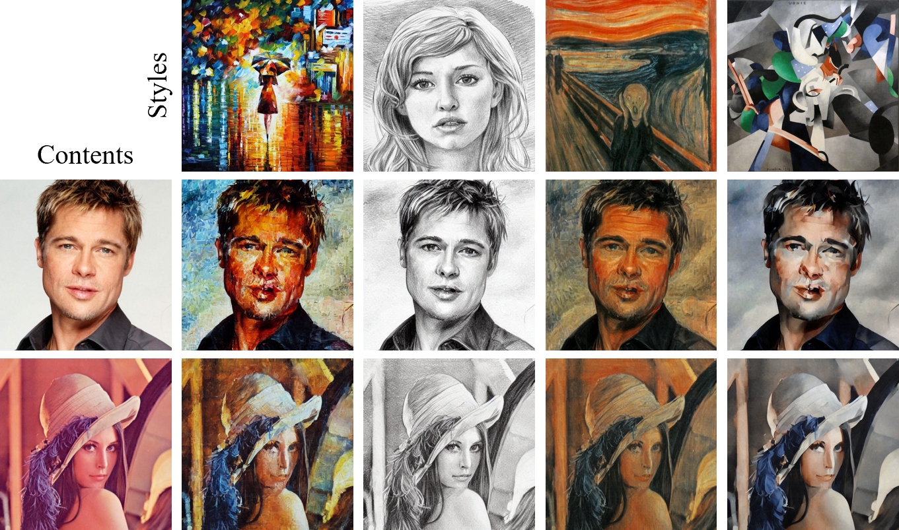

# [CVPR 2024 Highlight] Style Injection in Diffusion: A Training-free Approach for Adapting Large-scale Diffusion Models for Style Transfer

### [Paper](https://openaccess.thecvf.com/content/CVPR2024/html/Chung_Style_Injection_in_Diffusion_A_Training-free_Approach_for_Adapting_Large-scale_CVPR_2024_paper.html) / [Arxiv](https://arxiv.org/abs/2312.09008) / [Project Page](https://jiwoogit.github.io/StyleID_site/)



## Usage

**To run our code, please follow these steps:**

1. [Setup](#setup)
2. [Run StyleID](#run-styleid)
3. [Evaluation](#evaluation)

For the tested Windows/RTX 50-series Diffusers workflow, including automatic
model download with `hf download`, see [REPRODUCTION.md](REPRODUCTION.md).

It may require a single GPU with more than 20GB of memory.
I tested the code in the [pytorch/pytorch:1.8.1-cuda11.1-cudnn8-devel](https://hub.docker.com/layers/pytorch/pytorch/1.8.1-cuda11.1-cudnn8-devel/images/sha256-024af183411f136373a83f9a0e5d1a02fb11acb1b52fdcf4d73601912d0f09b1) Docker image.

#### ** You can also refer to "diffusers_implementation/" for StyleID implementation based on diffusers library. **

## Setup

Our codebase is built on ([CompVis/stable-diffusion](https://github.com/CompVis/stable-diffusion) and [MichalGeyer/plug-and-play](https://github.com/MichalGeyer/plug-and-play))
and has similar dependencies and model architecture.

### Create a Conda Environment

```
conda env create -f environment.yaml
conda activate StyleID
```

### Download StableDiffusion Weights

Download the StableDiffusion weights from the [CompVis organization at Hugging Face](https://huggingface.co/CompVis/stable-diffusion-v-1-4-original)
(download the `sd-v1-4.ckpt` file), and link them:
```
ln -s <path/to/model.ckpt> models/ldm/stable-diffusion-v1/model.ckpt 
```

## Run StyleID

For running StyleID, run:

```
python run_styleid.py --cnt <content_img_dir> --sty <style_img_dir>
```
For running default configuration in sample image files, run:
```
python run_styleid.py --cnt data/cnt --sty data/sty --gamma 0.75 --T 1.5  # default
python run_styleid.py --cnt data/cnt --sty data/sty --gamma 0.3 --T 1.5   # high style fidelity
```

To fine-tune the parameters, you have control over the following aspects in the style transfer:

- **Attention-based style injection** is removed by the `--without_attn_injection` parameter.
- **Query preservation** is controlled by the `--gamma` parameter.
  (A higher value enhances content fidelity but may result a lack of style fidelity).
- **Attention temperature scaling** is controlled through the `--T` parameter.
- **Initial latent AdaIN** is removed by the `--without_init_adain` parameter.

### Per-run evaluation records

The Diffusers runner evaluates every generated image against its content and
style references after saving it. It prints content-structure, grayscale SSIM,
edge-preservation, style-Gram, color, and local-patch diagnostics, then writes:

- `<output-name>.metrics.json`, containing the complete record for that run.
- `evaluation_records.csv` in the selected result directory, with one appended
  row per run.

The CSV includes the input paths, DDIM steps, resolution, gamma, temperature,
device, precision, injection layers, feature switches, and every metric. The
reported `balanced_score` is a convenient within-experiment diagnostic, not an
absolute perceptual-quality judgment. Keep the individual content and style
metrics for analysis.

### Pre-transfer top-k attention experiment

From the repository root, run:

```powershell
.\.venv\Scripts\python.exe diffusers_implementation\experiment_topk.py
```

By default this matches content `00.png` with every style, recomputes DDIM
inversion features, and joins the existing default-run JSON records under
`results/all_default`. It does not regenerate stylized images. To repeat the
analysis with other content images, pass `--contents data/cnt/00.png
data/cnt/01.png data/cnt/02.png`; all specified pairs must already have matching
evaluation records. Use a separate `--save_dir` for different configurations.
Completed pairs can be resumed, provided their recorded inputs and settings
still match. `--limit_styles 2` is useful for a short smoke run.

`results/experiment_topk` contains `pair_summary.csv`, per-head and per-timestep
`head_timestep_details.csv`, `correlations.json`, scatterplots, layer curves,
and resumable pair records. The main statistic is the fraction of full-softmax
attention mass assigned to the highest-scoring 1% of style keys, averaged
equally over queries, heads, steps, and layers. The auxiliary IQR is calculated
across queries within each head and then averaged. Correlations use paired
bootstrap confidence intervals and two-sided permutation tests over styles.
The `Qc/Ks` features come from inversion and do not include the generation-time
mixed query; they are predictive candidates, not the actual generation-time
attention. Existing evaluation records did not store input hashes or a model
revision, so exact historical provenance of the generated outputs cannot be
verified. The result metrics are unvalidated proxies, not human quality labels.

### Style-image local gradient experiment

```powershell
.\.venv\Scripts\python.exe diffusers_implementation\experiment_style_gradient.py
```

This uses the existing default-run records and does not run the model. It crops
each style image to its central square, resizes it as in the StyleID runner,
converts it to grayscale in [0, 1], and records the mean magnitude of the 3x3
Sobel gradient (scale 1/8, reflected borders). This measures local intensity
variation, including image content edges, noise, and texture: it is not a
validated brushstroke or style-intensity measurement.

Results are saved under `results/experiment_style_gradient`: one row per style,
the joined content/style records, correlations by content, a summary, and
scatterplot grids for the two primary metrics. Each content image has a
separate Spearman correlation over the same styles, paired bootstrap interval,
and permutation p-value. Benjamini-Hochberg correction covers the two primary
metrics across all content images. Other output metrics are exploratory, not
additional independent proofs. Because the same styles recur across contents,
the count of agreeing content correlations is descriptive, not an independent
sample-size multiplier. The local-patch evaluation score also uses gradients,
so correlation with it can partly reflect shared measurement ingredients.

### Input local-structure matching experiment

```powershell
.\.venv\Scripts\python.exe diffusers_implementation\experiment_local_matching.py
```

The script reuses the existing default-run output records. It divides each
preprocessed image into 8x8 patches and computes unsigned, gradient-weighted
orientation histograms plus bounded gradient activity. Each content patch is
matched to its three most similar style patches. The main candidate score is
the average similarity for content patches with activity at least 0.10; if
fewer than four qualify, it is undefined. These thresholds, weights and patch
sizes are initial exploratory choices, not perceptually calibrated parameters.

Outputs under `results/experiment_local_matching` include pair scores,
per-patch scores, correlations computed separately by content and by style,
and scatterplot grids. Bootstrap intervals and permutation tests treat the
varying image in each group as the unit; BH correction covers both metrics
and both grouping directions. Reused images make the separate group results
dependent, so counts of positive or significant groups are descriptive.
This grayscale measure is not StyleID's Q/K matching and cannot identify
semantic correspondences, style quality or causation. The existing local style
score also uses gradients, so shared measurement ingredients must be considered.

### Attention temperature ablation

To compare the first content image with all styles using attention scale 1.0
against the existing default scale 1.5 results:

```powershell
.\.venv\Scripts\python.exe diffusers_implementation\run_styleid_batch.py --limit_contents 1 --T 1.0 --save_dir results\temperature_ablation_t1
.\.venv\Scripts\python.exe diffusers_implementation\compare_temperature_ablation.py
```

`T=1.0` leaves the query unscaled in this implementation; default `T=1.5`
multiplies the query and therefore the scaled-dot-product logits by 1.5. Other
default settings, including initial AdaIN, are retained. The comparison joins
records by image paths, checks saved settings, and reports `T=1.0 - T=1.5`
for each metric with a paired bootstrap interval over the 46 styles. It also
writes a grid of the first eight image pairs for visual inspection. Existing
baseline records do not contain historical image hashes, code/model revision,
or complete environment details; automatic diagnostics are not validated
perceptual scores, and results for one content image cannot establish general
performance. Attention temperature changes the entire generation trajectory.

### Input similarity and attention injection audit

The following exploratory analysis checks how much of an output score might
reflect the content/style images being similar even before generation:

```powershell
.\.venv\Scripts\python.exe diffusers_implementation\experiment_baseline_gain.py
```

It reuses the evaluator's patch and color metrics on the input pair and
compares them to output scores and output-minus-input changes. As the input
and output use the same measure, association can reflect shared metric
construction. In particular, correlation between a baseline and its change
can arise mathematically; it does not establish a causal effect.

For a separate attention-intervention control, generate the full default
dataset with style key/value injection disabled while retaining initial AdaIN:

```powershell
.\.venv\Scripts\python.exe diffusers_implementation\run_styleid_batch.py --without_attn_injection --save_dir results\attention_disabled_c00
.\.venv\Scripts\python.exe diffusers_implementation\experiment_attention_full.py
```

The comparison measures `SSIM(injection on) - SSIM(injection off)` and its
association with input patch similarity separately for each content image.
Contents 00-05 were used to explore the hypothesis; contents 06-19 are a
follow-up with the same style images and already examined input/default data.
They are not independent external validation. Holm correction covers the 14
follow-up tests; per-content bootstrap resamples styles. The experiment tests
a change of the whole generation trajectory, not intervention on the input
similarity itself. SSIM and the other project metrics are not validated human
judgments, and historical baseline provenance lacks hashes and model revision.

The fixed hypothesis can also be examined on the repository's `data_vis`
demonstration images. Generate both arms, then run the validation script:

```powershell
.\.venv\Scripts\python.exe diffusers_implementation\run_styleid_batch.py --cnt_dir data_vis\cnt --sty_dir data_vis\sty --save_dir results\external_eval_on
.\.venv\Scripts\python.exe diffusers_implementation\run_styleid_batch.py --cnt_dir data_vis\cnt --sty_dir data_vis\sty --without_attn_injection --save_dir results\external_eval_off
.\.venv\Scripts\python.exe diffusers_implementation\experiment_unseen_validation.py
```

This uses 9 contents and 13 styles, with crossed content/style bootstrap and
Holm correction for per-content tests. These are demonstration images from
the same repository, not a representative external benchmark. The follow-up
`experiment_unseen_sensitivity.py` is post-hoc exploratory, not an independent
confirmation of its additional comparisons.

### Human-rated dataset and LPIPS sensitivity

The CC BY 4.0 ArtFlow dataset from
`https://github.com/victorkitov/style-transfer-dataset` is kept under
`downloads/style-transfer-dataset`. `experiment_artflow_human.py` tests the
input descriptor against its three-rater mean scores for style size 500;
`experiment_artflow_human_sensitivity.py` explores other style sizes and raters.
These are ratings of recolored ArtFlow outputs, **not** StyleID outputs.

`experiment_lpips_content.py` calculates LPIPS v0.1 (AlexNet) on StyleID on/off
images using official TorchVision weights and LPIPS calibration weights from
`https://github.com/richzhang/PerceptualSimilarity`. The implementation is
checked against the upstream metric by `check_lpips_reference.py`. LPIPS is a
content perceptual distance, not a standalone style or overall-quality score.

`create_blind_review.py` creates a 12-pair local human-rating pilot under
`results/blind_review_pilot`; it refuses to overwrite an existing pilot. The
HTML page stores progress in the local browser and exports scores as JSON. Its
separate answer key records the randomized on/off assignment; do not inspect
the key before rating. Multiple raters should export their scores and then
reset browser progress, or use separate browser profiles.

### Save Precomputed Inversion Features
By default, it generates a "precomputed_feats" directory and saves the DDIM inversion feature of each input image.
This reduces the time for two DDIM inversions but requires a significant amount of storage (over 3 GB for each image).
If you encounter "no space left" error, please set the "precomputed" parameter as follows:

```
python run_styleid.py --precomputed "" # not save DDIM inversion features
```

## Evaluation

For a quantitative evaluation, we incorporate a set of randomly selected inputs from [MS-COCO](https://cocodataset.org) and [WikiArt](https://github.com/cs-chan/ArtGAN/tree/master/WikiArt%20Dataset) in "./data" directory.


Before executing evalution code, please duplicate the content and style images to match the number of stylized images first. (40 styles, 20 contents -> 800 style images, 800 content images)

run:
```
python util/copy_inputs.py --cnt data/cnt --sty data/sty
```

We largely employ [matthias-wright/art-fid](https://github.com/matthias-wright/art-fid) and [mahmoudnafifi/HistoGAN](https://github.com/mahmoudnafifi/HistoGAN) for our evaluation.

### Art-fid
run:
```
cd evaluation;
python eval_artfid.py --sty ../data/sty_eval --cnt ../data/cnt_eval --tar ../output
```

### Histogram loss
run:
```
cd evaluation;
python eval_histogan.py --sty ../data/sty_eval --tar ../output
```

Also, we additionally provide the style and content images for qualitative comparsion, in "./data_vis" directory.

## Citation
If you find our work useful, please consider citing and star:
```BibTeX

@InProceedings{Chung_2024_CVPR,
    author    = {Chung, Jiwoo and Hyun, Sangeek and Heo, Jae-Pil},
    title     = {Style Injection in Diffusion: A Training-free Approach for Adapting Large-scale Diffusion Models for Style Transfer},
    booktitle = {Proceedings of the IEEE/CVF Conference on Computer Vision and Pattern Recognition (CVPR)},
    month     = {June},
    year      = {2024},
    pages     = {8795-8805}
}
```
